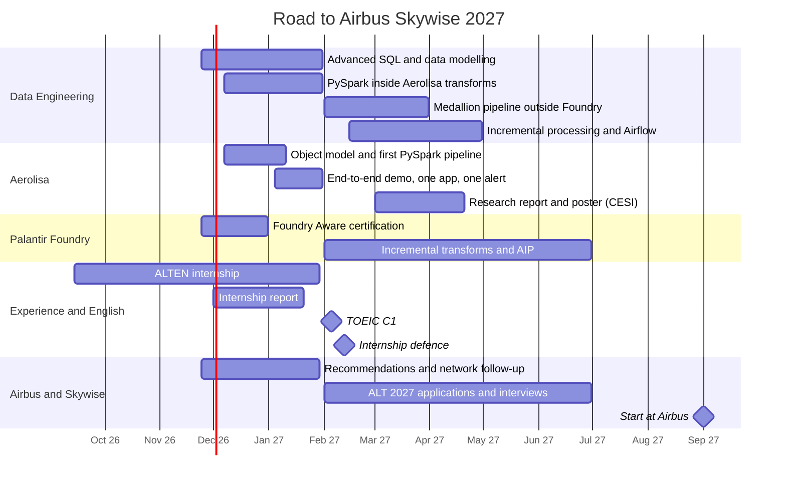

# Roadmap: November 2026 → September 2027

**Goal:** join Airbus as a Data Engineer apprentice in September 2027, ready to contribute to Skywise and Foundry-based data products from the first weeks.

**The order matters:** secure what the internship can give me while I am still there, build the PySpark and Ontology proof in December and January, then apply as soon as the 2027 apprenticeship offers open in spring.

Status: ✅ done · 🔄 in progress · ⬜ planned

---

## Overview

---

## Phase 1 · Secure & certify (Nov 2026 – Jan 2027)

*Lock in what the internship can give me, and build the first real Foundry proof.*

| Milestone | Workstream | Target | Status |
|---|---|---|---|
| 4th Palantir certification: Creating Your First Data Connection | Foundry | Nov 2026 | ✅ |
| Advice session with a Skywise expert, turned into a learning plan | Airbus & Skywise | Nov 2026 | ✅ |
| Repository restructured around what I learned | Airbus & Skywise | Nov 2026 | ✅ |
| Recommendations from my company tutor and the managers who used my work | Experience | Jan 2027 | ⬜ |
| Palantir Foundry Aware certification | Foundry | Dec 2026 | 🔄 |
| Advanced SQL: joins, GROUP BY, window functions, CTE deduplication, without help | Data Engineering | Jan 2027 | 🔄 |
| Aerolisa object model (Aircraft, Engine, Flight, Maintenance alert) and first PySpark pipeline on C-MAPSS | Aerolisa | Jan 2027 | ⬜ |
| Aerolisa end-to-end demo: one app, one alert, model error explained | Aerolisa | Jan 2027 | ⬜ |
| Internship midterm review (tripartite) | Experience | 4 Dec 2026 | ⬜ |
| Internship report submitted | Experience | 20 Jan 2027 | ⬜ |
| CV and LinkedIn aligned with this repository; public repos checked for confidential data | Airbus & Skywise | Jan 2027 | ⬜ |

## Phase 2 · Prove (Feb – Apr 2027)

*Validate the skills with results anyone can check.*

| Milestone | Workstream | Target | Status |
|---|---|---|---|
| TOEIC Listening & Reading, C1 level | English | 1st week of Feb 2027 | ⬜ |
| Internship final defence | Experience | 2nd week of Feb 2027 | ⬜ |
| Medallion pipeline on C-MAPSS: MinIO → dbt / Polars / Spark → Airflow, with tests | Data Engineering · Aerolisa | Mar 2027 | ⬜ |
| Incremental processing, Parquet + Delta Lake or Iceberg, monitoring dashboard | Data Engineering | Apr 2027 | ⬜ |
| Predictive maintenance research: final report and poster | Aerolisa | 12 & 20 Apr 2027 | ⬜ |

## Phase 3 · Apply (Feb – Jun 2027)

*Most Airbus apprenticeship offers for a September start are posted between March and May.*

| Milestone | Workstream | Target | Status |
|---|---|---|---|
| Watch Airbus careers for "ALT 2027" Skywise and data offers; prioritise 1-year-compatible offers | Airbus & Skywise | From Feb 2027 | ⬜ |
| Applications sent with RNCP code, contract type and dates ready | Airbus & Skywise | Feb – May 2027 | ⬜ |
| Video interviews, technical tests and manager interviews | Airbus & Skywise | Mar – Jun 2027 | ⬜ |

## Phase 4 · Transition (Jul – Sep 2027)

*Arrive ready to contribute.*

| Milestone | Workstream | Target | Status |
|---|---|---|---|
| Apprenticeship contract signed | Airbus & Skywise | Jul 2027 | ⬜ |
| Onboarding preparation: team context, data domain, Foundry conventions | Airbus & Skywise | Aug 2027 | ⬜ |
| **Start at Airbus** | — | **Sep 2027** | ⬜ |

---

## Where I stand today

Compared with what real 2025–2026 Airbus Skywise apprenticeship offers ask for: Python and SQL, PySpark in Foundry, dashboards and apps, and explaining data to non-specialists in English.

| Skill | Evidence today | Gap | How I close it |
|---|---|---|---|
| Python, pandas | Data cleaning scripts at ALTEN; RUL research code | Small | Show the logic in public, on public data |
| Dashboards, KPIs | Power BI reporting for France and UK stakeholders | Not yet in Foundry tools | Aerolisa inspection queue in Workshop |
| SQL | Daily use, but little visible proof | Medium | Aerolisa transforms in SQL as well as PySpark |
| PySpark | Not yet at scale | **Large** | One real PySpark pipeline in Aerolisa, then the medallion pipeline |
| Ontology modelling | Certifications | **Large** | Aerolisa object model with an Installation link for engines |
| Incremental processing, orchestration | Concepts only | **Large** | Medallion pipeline with Airflow and incremental loads |
| Aviation data vocabulary | C-MAPSS research | Medium | [knowledge/aerospace-domain.md](knowledge/aerospace-domain.md): AOG, MCC, MRO, ATA chapters, reliability KPIs |
| English | Engineering degree taught in English; daily work with UK stakeholders | Proof | TOEIC score |
| Communication | Deliverables for managers and recruiters | Medium | Present Aerolisa out loud, often, in French and English |

---

## Definition of ready

I am ready for September 2027 when I can, without notes:

- [ ] Explain Skywise in 30 seconds, with current facts
- [ ] Explain Skywise Fleet Performance+, predictive maintenance and health monitoring in one sentence each
- [ ] Draw a small Ontology for aircraft maintenance on a whiteboard, including engines that move between aircraft
- [ ] Show a PySpark pipeline I wrote, in a public repository, and explain every line
- [ ] Write a SQL query with a JOIN, a GROUP BY and a window function without help
- [ ] Explain the medallion architecture with my own bronze / silver / gold layers on engine data
- [ ] Explain when to choose pandas, Polars or Spark, and batch or incremental
- [ ] Walk through how I would investigate a dashboard that suddenly shows 30% fewer flights
- [ ] Present Aerolisa in 5 minutes: problem, pipeline, object model, app, result
- [ ] Work and present in English at C1 level

## How I work

- **Weekly rhythm:** Saturdays for mathematics, Sundays for computer science; English every day.
- **Tracking:** a detailed task plan reviewed weekly, summarised here as milestones.
- **Accountability:** a public progress update every month in [progress/](progress/).

Back to [README](README.md)
