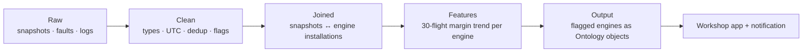

# Case study: fleet-relative engine margin alert

> A design exercise on a Skywise-style problem, worked through as I would in a team: questions first, then a simple, trusted version, then sophistication.

## Brief

An airline wants an alert when an engine's **exhaust gas temperature (EGT) margin** degrades faster than the rest of the fleet. Available: per-flight engine snapshots from 200 aircraft, fault messages, and maintenance logs exported from another system.

## 1 · Questions before designing

- Who acts on the alert, and how much warning do they need: days or weeks?
- How many false alarms will they tolerate before ignoring it?
- Which engine types? How much history? One snapshot per flight or per flight phase?
- How are engine removals recorded in the maintenance system?
- How often must the alert refresh?
- What exactly does "faster than the fleet" mean?

## 2 · Pipeline

Five layers, each a versioned dataset with tests.



## 3 · The hard part: engines move between aircraft

The **engine serial number (ESN)** is the key, not the aircraft. From the maintenance logs, build an installation history: ESN, aircraft, installed on, removed on. Each snapshot joins on aircraft **and** on its timestamp falling inside an installation period. That gives the true engine behind every data point. After a shop visit, restart the trend, because the margin is restored.

## 4 · Quality checks per step

| Step | Checks |
|---|---|
| Raw | Schema, freshness, volume per airline |
| Clean | No missing ESN, temperatures within physical limits, no duplicate snapshots, valid timestamps |
| Join | Every snapshot matches exactly one installation; unmatched rate tracked |
| Features | Minimum number of flights before computing a trend |
| Output | If alerts suddenly spike, check the data before alerting anyone |

## 5 · The flagging logic (PySpark)

Take each engine's last 30 flights, compute the slope of the margin, and compare it with the 5th percentile for its engine type. The most negative slopes degrade fastest.

```python
from pyspark.sql import functions as F, Window as W

w = W.partitionBy("esn").orderBy(F.col("flight_ts").desc())

recent = (
    snapshots
    .withColumn("rn", F.row_number().over(w))
    .filter(F.col("rn") <= 30)
    .withColumn("x", -F.col("rn"))          # older flight = smaller x
)

trend = (
    recent.groupBy("esn", "engine_type")
    .agg(
        F.count("*").alias("n_flights"),
        (F.covar_samp("x", "egt_margin") / F.var_samp("x")).alias("slope"),
    )
    .filter(F.col("n_flights") >= 20)       # not enough history = no verdict
)

p5 = trend.groupBy("engine_type").agg(
    F.expr("percentile_approx(slope, 0.05)").alias("p5_slope")
)

alerts = trend.join(p5, "engine_type").filter(F.col("slope") <= F.col("p5_slope"))
```

**Edge cases:** engines with too little history; a shop visit inside the 30-flight window (should reset the trend, so filter snapshots to the current installation and the period after the last shop visit); engine types with only a handful of engines, where a percentile means little.

## 6 · Reaching the engineer

An **Engine** object in the Ontology with its trend and alert status, linked to its Aircraft and Maintenance events. A Workshop page lists flagged engines with a trend chart each. The engineer gets a notification and can **acknowledge** or **create a work order**. Their response is recorded, so we learn which alerts were useful and tune the threshold.

## 7 · Running it in production

Daily schedule, incremental transforms on new snapshots plus a lookback window for late data. Health checks on every dataset, alerts to the pipeline owner on failure. Reruns are safe because transforms are idempotent. Beyond the pipeline, monitor the product: alerts per week and the share engineers mark as useful.

## 8 · Delivery plan

| When | What |
|---|---|
| **2 weeks** | Clean data for one fleet, the simple percentile rule, a basic Workshop view shown to one engineer for feedback |
| **3 months** | All fleets, production incremental pipeline with monitoring, the feedback loop, and possibly an ML model, kept only if it beats the simple rule |

**Trust first, sophistication second.**
