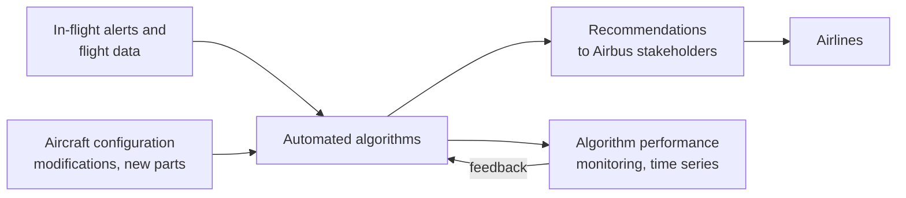

# Airbus & Skywise

> Public information only, in my own words. Sources at the bottom. Last checked: November 2026.

## Airbus at a glance

- **Divisions:** Commercial Aircraft · Helicopters · Defence and Space
- **Commercial families:** A220 · A320 family · A330 · A350
- **2025:** 793 commercial aircraft delivered (93 A220, 607 A320 family, 36 A330, 57 A350) to 91 customers; record backlog of 8,754 aircraft; revenue €73.4 billion (+6%)
- **2026 guidance:** around 870 deliveries. Demand is not the constraint: deliveries are limited by the supply chain, engines in particular
- **Values:** customer focus, integrity, respect, creativity, reliability, teamwork

## Skywise in 2026

| Topic | What to know |
|---|---|
| **Origin** | Airbus and Palantir first worked on Airbus's own operations: finding bottlenecks in the A350 production supply chain |
| **Launch** | June 2017 (Paris Air Show), opened to airlines as an open aviation data platform |
| **Palantir** | Multi-year extension signed on 10 February 2026; Palantir remains the core technology provider. The announcement stresses AI capabilities with multiple LLMs and a path to sovereign cloud environments |
| **Subsidiary** | 1 April 2026: Skywise digital solutions and **Navblue** (flight operations software) merged into one wholly owned company, about 750 people in France, the UK, the USA, Canada, India, Poland, Singapore, Thailand and more |
| **Scale** | 12,000+ connected aircraft |
| **Business model** | Skywise Core is offered to airlines in exchange for sharing operational data on their Airbus aircraft ("shared value") |
| **Latest** | 2 November 2026: Airbus digital flight training solutions (MATe Suite, Virtual Procedure Trainer, Flight eLearning) moved into the Skywise portfolio |

### Products I can explain in one sentence each

- **Skywise Core [X]:** the data backbone that integrates Airbus aircraft data with airlines' operational data.
- **Skywise Fleet Performance+ (S.FP+):** the fleet health bundle covering three domains: health monitoring, predictive maintenance and reliability. JetBlue signed for it in April 2026 for its A320 family and A220 fleets.
  - **Predictive maintenance:** predicts component failures from abnormal behaviour in aircraft sensor data. This is what Aerolisa's first slice does at small scale.
  - **Health monitoring:** real-time aircraft health and troubleshooting for line maintenance and maintenance control centres.
  - **Fleet reliability:** benchmarks an airline's reliability against the worldwide fleet.
- **Navblue:** flight operations and flight planning software, now part of Skywise.

### Two meanings of "Skywise"

1. **The company and its products**, sold to airlines (above).
2. **Airbus's internal big data platform**, used across engineering, quality, procurement, customer services and manufacturing. Most apprenticeship offers are here.

### Who competes with it

Boeing's digital services, MRO platforms such as Lufthansa Technik's AVIATAR, and engine makers' own analytics (e.g. GE). Skywise's edge: it comes from the aircraft manufacturer, with design knowledge, 12,000+ connected aircraft and, since 2026, flight operations tools through Navblue.

## How Skywise turns flight data into recommendations

The heart of Skywise is maintenance: turning flight data into recommendations that keep aircraft from being grounded (AOG).

1. Alerts and everything that happened during the flight are collected.
2. They feed automated algorithms.
3. The algorithms produce recommendations for Airbus stakeholders, who pass them on to airlines.
4. Algorithm performance is monitored over time, which is what makes it possible to automate the whole loop.
5. Each aircraft's **configuration** is taken into account: the link between the exact aircraft and the improvements brought by modifications and new parts.

**In practice:** predictive maintenance often relies on a few fairly simple algorithms. The value comes from data quality and the link to the business, not from model complexity.

### The business value, in airline terms

- **OI (Operational Interruption):** delays and cancellations.
- **OR (Operational Reliability):** aircraft availability.
- **AOG penalties:** an aircraft on the ground costs a lot, so every well-anticipated alert has direct business value.

## What a Data Engineer does around Skywise

- **Starts from the business case.** The data architecture is not fixed in advance; it is defined per use case. Problem first, then data, layers and tools.
- **Delivers reliable data** that feeds the dashboards and apps presented to stakeholders.
- **Migrates and decouples.** Moving legacy software and processing to modern cloud pipelines, and meeting data sovereignty requirements, are active themes; knowing how to decouple a platform is a sought-after skill.
- **Works with analysts.** The analyst says what is needed; the engineer guarantees reliable data; official tests validate both. On small projects one person may do both.
- **Monitors.** Dashboards on pipelines and data catch problems before they reach the business.
- **Works at scale with partners.** Agile teams, and SAFe when several companies (Airbus, subcontractors) deliver together.

## Sources

- [Airbus: 793 commercial aircraft deliveries in 2025](https://www.airbus.com/en/newsroom/press-releases/2026-01-airbus-reports-793-commercial-aircraft-deliveries-in-2025)
- [Airbus: FY 2025 results](https://www.airbus.com/en/annual-press-conference-2026)
- [Airbus: Skywise subsidiary integrating Navblue (1 Apr 2026)](https://www.airbus.com/en/newsroom/press-releases/2026-04-airbus-unveils-skywise-subsidiary-integrating-navblue-and-skywise-digital-services-solutions)
- [Airbus: With Skywise, Airbus is re-imagining the digital sky](https://www.airbus.com/en/newsroom/stories/2026-04-with-skywise-airbus-is-re-imagining-the-digital-sky)
- [Business Wire: Palantir and Airbus extend strategic collaboration (10 Feb 2026)](https://www.businesswire.com/news/home/20260210301221/en/Palantir-and-Airbus-Extend-Strategic-Collaboration/)
- [Skywise: JetBlue signs for Skywise Fleet Performance+ (21 Apr 2026)](https://www.skywise.com/en/newsroom/press-releases/2026-04-jetblue-signs-for-skywise-fleet-performance-solution)
- [Airbus: Skywise expands its portfolio with digital flight training (2 Nov 2026)](https://www.airbus.com/en/newsroom/press-releases/2026-11-skywise-expands-its-portfolio-with-the-launch-of-enhanced-digital-flight-training-solutions)
- Advice session with a Skywise expert working with Airbus teams (November 2026): business loop, role of the data engineer
